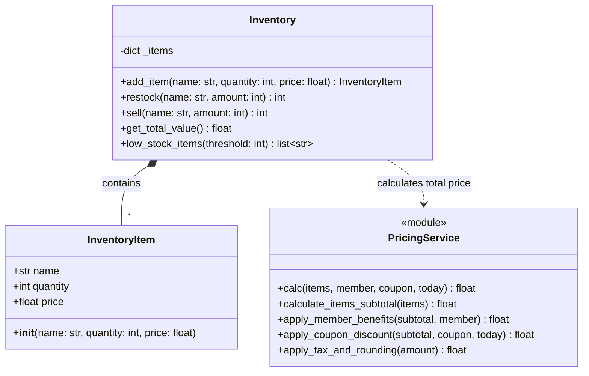
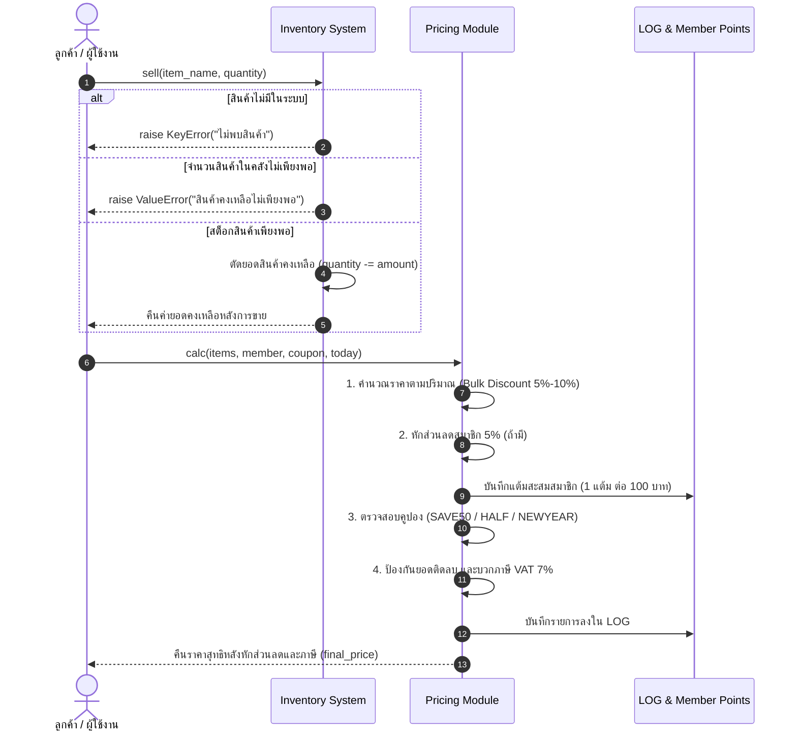

# โครงงานพัฒนาระบบคลังสินค้า (Smart Inventory System)

**รายวิชา**: Software Engineering in AI Era  
**Repository**: [swe-inventory-67332110157-3](https://github.com/kanissi-art/Kanis-Singkham-67332110157-3--swe-inventory)

---

## สารบัญตรวจโครงงาน (Project Checklist Links)

เอกสาร `PROJECT.md` นี้รวบรวมลิงก์ไปยังชิ้นงานสำคัญทั้ง 5 ด้านสำหรับการตรวจประเมินโครงงาน โดยสามารถคลิกลิงก์ในแต่ละหัวข้อเพื่อเปิดดูไฟล์งานได้โดยตรง:

### 1. Spec ของระบบ (System Specifications & Requirements)
- 📄 **เอกสารความต้องการและขอบเขตระบบ**: [lab04-ai-coding-ux/findings-lab04.md](lab04-ai-coding-ux/findings-lab04.md)  
  *ครอบคลุม User Needs, Pain Points, Surprises, และ Point of View (POV) สำหรับระบบจัดการสินค้า 2 ชนิด (Physical Items และ Digital Files/E-books)*
- 📄 **กฎทางธุรกิจและการคิดราคา (Pricing Business Logic)**: [pricing.py](pricing.py)

---

### 2. Class Diagram หรือ Sequence Diagram (System Architecture)
- 📊 **เอกสารและแผนภาพสถาปัตยกรรมระบบ**: [docs/diagrams.md](docs/diagrams.md)  
  *ประกอบด้วย Class Diagram ของ Inventory / InventoryItem / PricingService และ Sequence Diagram กระบวนการขายและการคำนวณราคา*

#### Class Diagram

#### Sequence Diagram (กระบวนการขายและคิดราคา)

---

### 3. งานฝั่งผู้ใช้ (User Experience, Persona, Wireframe & Accessibility)
- 👤 **Persona (สมหมาย รักงาน - พนักงานคลังสินค้า)**: [lab04-ai-coding-ux/persona.md](lab04-ai-coding-ux/persona.md)
- 🖼️ **Wireframe & UI Design Mockups**: [lab04-ai-coding-ux/assets/](lab04-ai-coding-ux/assets/)
- ♿ **ผลการตรวจ Accessibility Checklist (WCAG 2.1 AA)**: [lab04-ai-coding-ux/accessibility-review.md](lab04-ai-coding-ux/accessibility-review.md)

---

### 4. Test อัตโนมัติ และหน้าผลการรัน CI (Automated Testing & CI/CD)
- 🧪 **ชุดทดสอบคลังสินค้า (Inventory TDD & Sell Edge Cases รวม 17 ข้อ)**: [tests/test_inventory.py](tests/test_inventory.py)
- 🧪 **ชุดทดสอบ Characterization Test ของโมดูลราคา (16 ข้อ)**: [tests/test_pricing_legacy.py](tests/test_pricing_legacy.py)
- ⚙️ **การตั้งค่า CI Workflow**: [.github/workflows/ci.yml](.github/workflows/ci.yml)
- 🚀 **หน้าผลการรัน CI ที่ผ่านจริงบน GitHub Actions**:
  - [GitHub Actions Run #38052001446 (Status: Success ✅)](https://github.com/kanissi-art/Kanis-Singkham-67332110157-3--swe-inventory/actions/runs/38052001446)
- 📈 **บันทึกผลการวัด Coverage (100% ครอบคลุมสมบูรณ์)**: [coverage-note.md](coverage-note.md)

---

### 5. บันทึกการใช้ AI (AI Collaboration, Review & Ethics)
- 🤖 **การเปรียบเทียบ Prompt แบบสั้น กับ Context Engineering**: [lab04-ai-coding-ux/prompt-vs-context.md](lab04-ai-coding-ux/prompt-vs-context.md)
- 🔍 **บันทึกการ Review โค้ดที่ AI สร้าง และการค้นหา Root Cause**: [lab04-ai-coding-ux/code-review.md](lab04-ai-coding-ux/code-review.md) และ [lab04-ai-coding-ux/debug-log.md](lab04-ai-coding-ux/debug-log.md)
- 🎯 **การจับ Test ที่ AI เขียนแล้วผ่านง่ายเกินไป (Test Gap Analysis)**: [test-gap.md](test-gap.md)
- 👃 **การตรวจหา Code Smell ในโค้ดเดิม 6 จุด**: [smells.md](smells.md)
- ⚖️ **การวิเคราะห์จริยธรรมยุค AI 4 ประเด็น พร้อมแนวปฏิบัติของตนเอง**: [ethics.md](ethics.md)
