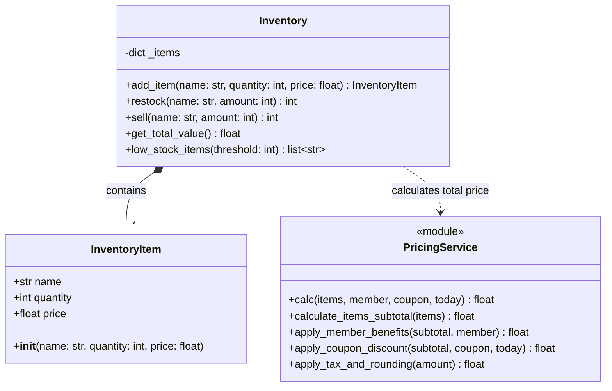
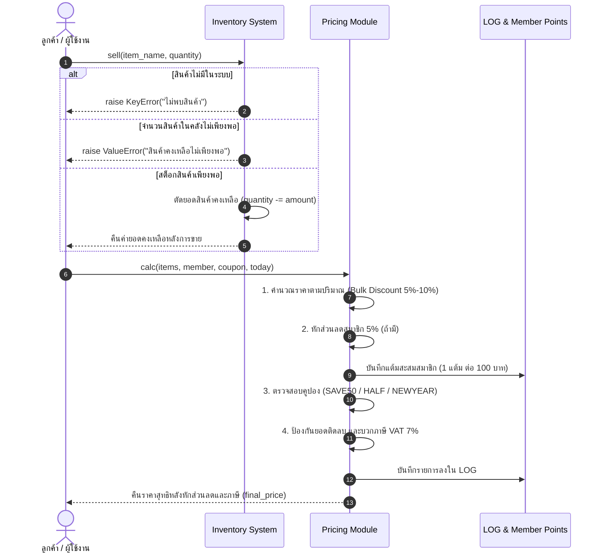

# แผนภาพสถาปัตยกรรมระบบ (System Architecture Diagrams)

เอกสารรวบรวม Class Diagram และ Sequence Diagram ของระบบคลังสินค้า (`swe-inventory`)

---

## 1. Class Diagram

แสดงโครงสร้างคลาส ความสัมพันธ์ และเมธอดหลักของระบบคลังสินค้าและระบบคิดคำนวณราคา:

---

## 2. Sequence Diagram (กระบวนการขายและคิดราคา)

แสดงลำดับการทำงาน (Workflow) เมื่อลูกค้าทำการซื้อสินค้าในระบบ พร้อมการคิดส่วนลดและบันทึกประวัติ Transaction:

